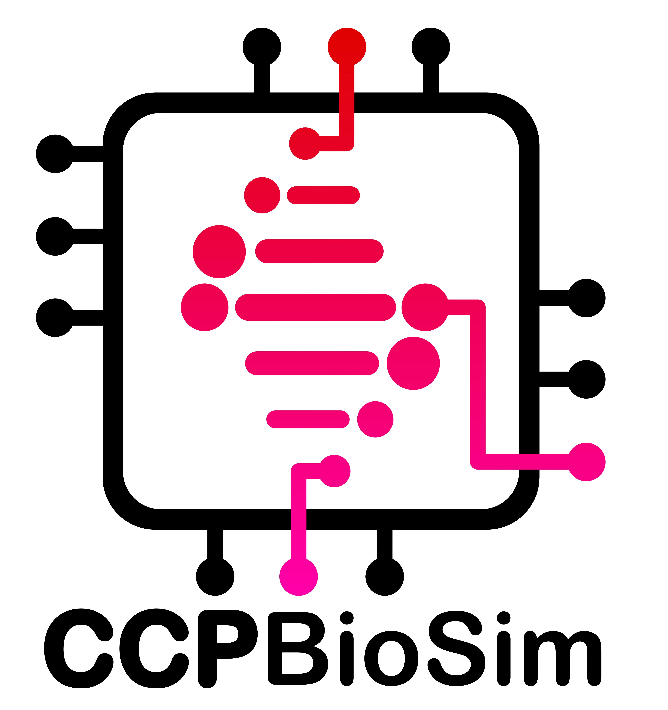

:html_theme.sidebar_secondary.remove:

biosim-schema
=============

.. ccpbiosim-hero::
   :logo-light: _static/logos/biosim-schema-logo-dark-text.png
   :logo-dark: _static/logos/biosim-schema-logo-light-text.png
   :logo-alt: biosim-schema logo
   :tagline: Schema for biomolecular simulation metadata created with LinkML
   :button: installation | Get started
   :github: CCPBioSim/biosim-schema

BioSim Schema provides a LinkML-based, reusable metadata model for biomolecular
simulation data, with tooling to validate terms and generate downstream
artefacts for BioSimDR workflows. These docs are for schema users and
contributors: they explain installation, day-to-day usage, contribution
workflows, generation/CI behavior, and where to find the schema reference.

Quick start
-----------

.. tab-set::

   .. tab-item:: pip

      .. code-block:: bash

         pip install biosim-schema

   .. tab-item:: Conda

      .. code-block:: bash

         conda install -c conda-forge -c ccpbiosim biosim-schema

Explore the documentation
-------------------------

.. grid:: 1 2 2 3
   :gutter: 3

   .. grid-item-card:: 🧬 Schema
      :link: schema_intro
      :link-type: doc

      What the schema covers and where to find the reference.

   .. grid-item-card:: 📦 Installation
      :link: installation
      :link-type: doc

      Install biosim-schema and its optional dependencies.

   .. grid-item-card:: 🚀 Usage
      :link: usage
      :link-type: doc

      Validate terms and generate artefacts.

   .. grid-item-card:: 👩‍💻 Contributing
      :link: contributing
      :link-type: doc

      How to propose changes to the schema.

   .. grid-item-card:: 🔄 Development Workflow
      :link: development_workflow
      :link-type: doc

      How generation and CI work.

.. toctree::
   :maxdepth: 2
   :hidden:

   Schema <schema_intro>
   Installation <installation>
   Usage <usage>
   Contributing <contributing>
   Development Workflow <development_workflow>

Funding
-------

Contributors to biosim-schema were supported by

